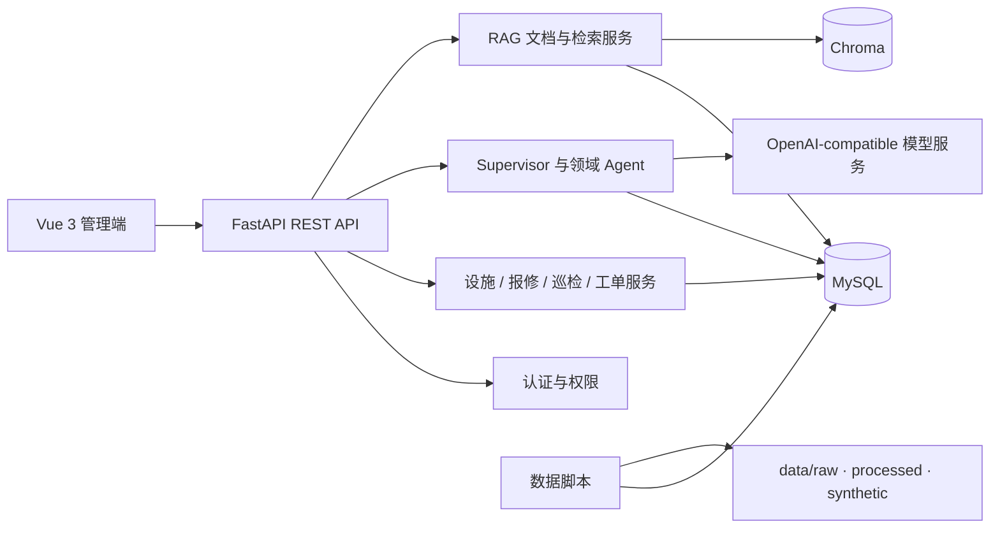

# Municipal Facility Operations

市政设施巡检与维修平台，面向道路、路灯、交通信号和公共设施的报修、分诊、设施匹配、巡检、派工、维修验收与知识问答。项目采用 FastAPI 后端、Vue 3 管理端、MySQL 业务库、Chroma 向量库和 LangGraph Agent 编排，覆盖从数据准备到运营工作台的完整工程骨架。

## 项目简介

### 业务目标

平台把城市设施问题处理拆成可追踪的业务闭环：

```text
公开数据 / 合成数据
        ↓
数据清洗与导入
        ↓
问题上报 → 问题分诊 → 设施识别
        ↓
巡检计划 → SLA 判断 → 工单调度
        ↓
安全作业 → 维修验收 → 审计与监控
        ↘
          RAG 知识检索与证据展示
```

### 核心边界

- 公开数据用于初始化、历史案例和统计分析，正式报修、派工、验收和审计记录进入 MySQL。
- 合成数据仅用于开发、演示和评测，记录带有 `source_type=synthetic`。
- 高风险或不可逆操作经过权限校验、状态机、幂等键和人工确认。
- RAG 文档保留来源、文档、分块和 Embedding 批次信息，便于问题定位和重建。
- Agent 运行记录包含运行状态、停止原因、工具调用、证据和审计信息。

## 技术栈

| 层次 | 技术 | 用途 |
|---|---|---|
| 后端 | Python 3.11、FastAPI、Uvicorn | REST API、健康检查、异常处理和请求上下文 |
| 数据访问 | SQLAlchemy、PyMySQL、MySQL 8 | 设施、报修、巡检、工单、Agent、审计和会话数据 |
| Agent | LangChain Core、LangGraph | Supervisor 循环、Agent 状态、工具调用和停止条件 |
| 模型 | OpenAI-compatible Chat / Embedding / Rerank API | 对话、向量生成和可选重排，服务地址由环境变量配置 |
| RAG | Chroma、文档解析、分块、Embedding、关键词检索、Rerank | 知识文档入库、检索、证据回溯和调试 |
| 前端 | Vue 3、TypeScript、Vue Router、Element Plus、ECharts | 管理后台、地图/看板、Agent 工作台和 RAG 工作台 |
| 工程化 | pytest、Ruff、mypy、Vite、Docker Compose | 测试、静态检查、构建和容器化部署 |
| 数据脚本 | Python、CSV/JSONL、SHA-256 manifest | 公开数据下载、清洗、合成、种子和备份 |

## 系统结构



## 目录结构

```text
municipal-facility-ops/
├── backend/
│   ├── app/
│   │   ├── api/routes/       FastAPI 路由：认证、设施、报修、巡检、工单、Agent、RAG、监控
│   │   ├── agents/            Supervisor、分诊、设施、SLA、调度、安全、验收 Agent
│   │   ├── tools/             Agent 工具契约、参数校验、工具执行器
│   │   ├── services/          领域服务、RAG、文档、Embedding、审计
│   │   ├── rag/               文档解析、分块、Embedding、召回、重排
│   │   ├── memory/            Agent 状态、会话记忆和运行上下文
│   │   ├── models/            MySQL ORM 模型
│   │   ├── schemas/           Pydantic 请求、响应和 Agent 契约
│   │   └── core/              配置、认证、安全、日志和监控
│   ├── tests/                 后端单元测试和业务链路测试
│   ├── .env.example           后端配置模板
│   └── Dockerfile             当前为 Step 36 容器化占位文件
├── frontend/
│   ├── src/views/             页面：总览、看板、设施、工单、Agent、RAG、记录、登录
│   ├── src/components/        设施、工单、SLA、证据、确认抽屉等组件
│   ├── src/dashboard/         城市运行大屏数据聚合
│   ├── src/stores/            认证、用户和菜单权限状态
│   ├── src/router/            页面路由和权限守卫
│   ├── src/api/               Axios 客户端与请求上下文
│   └── package.json           Vue、Element Plus、ECharts 和 Vite 配置
├── data/
│   ├── raw/public/            NYC 311、NYC DOT 等公开原始数据
│   ├── raw/docs/              Open311、维修规范和数据元数据
│   ├── processed/             清洗后的统一事件数据和质量报告
│   ├── synthetic/             设施、人员、SLA、报修、巡检、工单和验收样本
│   └── manifests/             来源、时间、筛选条件、文件大小和 SHA-256
├── infra/                     MySQL 初始化 SQL 和 Chroma 运行目录
├── scripts/                   下载、清洗、合成、导入、评测和备份脚本
├── evaluation/                Gold 数据集、基线配置和评测报告
├── docs/                      架构、执行手册、数据字典、设计和交付记录
├── uploads/                   RAG 文档上传暂存区
├── logs/                      应用、Agent、RAG、审计和评测日志
└── compose.yaml               当前为 Step 36 Compose 占位配置
```

## 快速开始

### 本地运行

#### 环境要求

- Windows 10/11 或 Linux/macOS
- Python 3.11+
- Node.js 22+
- MySQL 8+
- Chroma Server（默认端口 `8001`）
- 一个 OpenAI-compatible Chat 服务；Embedding 和 Rerank 可单独配置

#### 1. 配置环境变量

```powershell
Copy-Item backend/.env.example backend/.env
```

至少配置以下变量：

| 变量 | 说明 |
|---|---|
| `MYSQL_URL` | MySQL SQLAlchemy 连接串 |
| `CHROMA_HOST` / `CHROMA_PORT` | Chroma 服务地址 |
| `LLM_BASE_URL` / `LLM_API_KEY` / `LLM_MODEL` | Chat 模型服务 |
| `EMBEDDING_MODEL` | Embedding 模型名；可通过独立地址配置 |
| `AUTH_SECRET` | Token 签名密钥，生产环境使用随机长密钥 |
| `AUTH_BOOTSTRAP_USERNAME` / `AUTH_BOOTSTRAP_PASSWORD` | 首个管理员账号 |

不要提交 `.env`，也不要把 API Key 写入日志、测试夹具或备份文件。

#### 2. 启动依赖服务

使用本机 MySQL 和 Chroma，或按 [Windows IDE 直启指南](docs/Execution/windows-direct-start.md) 分终端启动：

```powershell
powershell -ExecutionPolicy Bypass -File scripts/start_windows.ps1 -Component mysql
powershell -ExecutionPolicy Bypass -File scripts/start_windows.ps1 -Component chroma
```

#### 3. 准备数据（可选）

```powershell
python scripts/download_public_data.py
python scripts/generate_synthetic_data.py
python scripts/prepare_data.py
python scripts/seed_database.py --data-root data --batch-id local
```

只检查不写入数据库：

```powershell
python scripts/seed_database.py --data-root data --batch-id local --dry-run
```

#### 4. 启动后端

```powershell
$env:PYTHONPATH = "backend"
python -m uvicorn app.main:app --reload --app-dir backend --host 127.0.0.1 --port 8000
```

后端入口：`http://127.0.0.1:8000`；Swagger：`http://127.0.0.1:8000/docs`。

#### 5. 启动前端

```powershell
Set-Location frontend
npm ci
npm run type-check
npm run build
npm run dev
```

前端地址：`http://127.0.0.1:5173`。Vite 将 `/api` 代理到 `http://localhost:8000`。

健康检查：

```powershell
Invoke-RestMethod http://127.0.0.1:8000/health
Invoke-RestMethod http://127.0.0.1:8000/ready
```

`/health` 只检查进程存活；`/ready` 会检查 MySQL、Chroma 和模型依赖。

### Docker 部署运行

#### 当前仓库状态

当前版本的 `compose.yaml`、`backend/Dockerfile` 和 `frontend/Dockerfile` 明确标注为 Step 36 占位文件，尚未形成可执行的容器化发布方案。因此下面的命令是目标部署契约，不能在当前提交上当作已验证的生产启动命令。

#### Step 36 完成后的目标命令

```powershell
Copy-Item backend/.env.example backend/.env
# 编辑 backend/.env，填写 MySQL、Chroma、LLM、认证和 CORS 配置
docker compose up -d --build mysql chroma backend frontend
docker compose ps
```

部署验收至少应覆盖：

1. MySQL 和 Chroma 健康检查。
2. 后端 `/health`、`/ready` 和 `/openapi.json`。
3. 前端首页、登录、Agent 工作台和 RAG 工作台。
4. 重新启动容器后数据库、Chroma 数据和日志卷仍可用。
5. `mysqldump`、文件备份和恢复查询可以完成。

正式容器化实现请按照 [Step 34 备份恢复](docs/Execution/step34-backup-restore.md)、[Step 35 文档交付](docs/Execution/step35-documentation-delivery.md) 和后续 Step 36 记录补齐。

## 页面与路由

### 前端页面路由

| 页面 | 前端路由 | 主要用途 | 权限 |
|---|---|---|---|
| 登录 | `/login` | 用户登录、Token 建立和当前用户恢复 | 公开 |
| 值守总览 | `/workspace` | 待确认 Agent、工单、设施和运行状态总览 | `agent:run` |
| 城市运行大屏 | `/dashboard` | 设施风险、工单 SLA、Agent 运行和依赖健康趋势 | `agent:read`，同时需要设施/工单读取权限 |
| 设施台账 | `/facilities` | 设施位置、状态、类型和问题历史 | `facility:read` |
| 工单中心 | `/work-orders` | 工单筛选、状态推进、SLA 和维修验收 | `work_order:read` |
| Agent 运行台 | `/agents/run` | 发起 Agent 运行、查看证据和人工确认 | `agent:run` |
| Agent 专项页 | `/agents/triage`、`facility`、`sla`、`inspection`、`dispatch`、`safety`、`acceptance` | 问题分诊、设施识别、SLA、巡检、调度、安全和验收 | `agent:run` |
| 文档管理 | `/rag/documents` | 上传、解析、分块预览和 Embedding 重建 | `document:read` / 写权限由后端控制 |
| RAG 检索 | `/rag/search` | 查询知识库并查看召回、重排和证据片段 | `document:read` |
| 运行记录 | `/records/runs` | Agent 运行记录和轨迹 | `agent:read` |
| 审计记录 | `/records/audit` | 权限、工具调用和状态变化审计 | `audit:read` |

### 页面与接口对照

| 页面 | 调用接口 | 方法 | 说明 |
|---|---|---|---|
| 登录 | `/api/auth/login` | POST | 用户名密码登录，返回访问 Token |
| 登录 / 全局用户 | `/api/auth/me` | GET | 读取当前用户、角色、权限和区域 |
| 值守总览 | `/api/work-orders`、`/api/facilities` | GET | 加载工单和设施摘要 |
| 值守总览 | `/api/monitoring/overview`、`/api/monitoring/runs` | GET | 加载运行指标和 Agent 运行列表 |
| 值守总览 | `/api/agents/runs/{run_id}`、`/confirmation` | GET / POST | 打开待确认运行并提交人工决定 |
| 城市运行大屏 | `/api/dashboard/overview` | GET | 按区域、设施类型、优先级、状态和时间范围聚合看板数据 |
| 设施台账 | `/api/facilities` | GET | 分页查询设施 |
| 设施台账 | `/api/facilities/nearby` | GET | 按坐标或区域查询附近设施 |
| 设施详情 | `/api/facilities/{facility_id}`、`/events` | GET | 读取设施详情和关联事件 |
| 工单中心 | `/api/work-orders`、`/{work_order_id}` | GET / POST | 查询、创建和读取工单 |
| 工单中心 | `/api/work-orders/{work_order_id}/status` | POST | 推进工单状态，支持幂等键和高风险确认 |
| 工单中心 | `/api/work-orders/{work_order_id}/acceptance` | POST | 提交维修验收结果和证据 |
| 工单中心 | `/api/work-orders/escalate-overdue` | POST | 批量升级逾期工单 |
| Agent 运行台 | `/api/agents/runs` | POST | 创建 Agent 运行；高风险意图进入待确认状态 |
| Agent 运行台 | `/api/agents/runs/{run_id}/trace` | GET | 查看观察、工具调用和轨迹事件 |
| Agent 运行台 | `/api/agents/runs/{run_id}/cancel` | POST | 取消运行 |
| Agent 运行台 | `/api/agents/runs/{run_id}/retry` | POST | 创建重试运行 |
| 文档管理 | `/api/rag/documents` | GET / POST | 查询或上传 RAG 文档 |
| 文档管理 | `/api/rag/documents/{document_id}/chunks` | GET | 查看分块 |
| 文档管理 | `/api/rag/documents/{document_id}/chunks/regenerate` | POST | 按目标 Token 和重叠度重新分块 |
| 文档管理 | `/api/rag/documents/{document_id}/embeddings/rebuild` | POST | 重建 Embedding 并写入 Chroma |
| RAG 检索 | `/api/rag/search`、`/search/debug` | POST | 普通检索或返回召回、过滤、重排调试信息 |
| 运行记录 | `/api/monitoring/runs`、`/overview` | GET | 查看 Agent 运行列表和监控指标 |
| 审计记录 | `/api/monitoring/audit` | GET | 查询审计事件 |
| 告警管理 | `/api/monitoring/alerts/{alert_id}/close` | POST | 关闭告警 |
| 存活与就绪 | `/health`、`/ready` | GET | 检查进程和真实依赖 |

所有接口的机器可读契约由 `/openapi.json` 提供；失败响应包含统一错误码、消息、`trace_id` 和 `retryable` 字段。

## 核心能力

### 设施与业务闭环

- 设施台账：位置、类型、状态、重要性、区域和条件评分。
- 问题上报：接收公开事件和内部报修，保留来源与原始字段。
- 巡检任务：创建、分配、状态更新和任务记录。
- 工单：创建、分页查询、状态机推进、逾期升级和维修验收。
- 审计：记录权限、工具调用、状态变化和人工确认。

### Agent 与安全控制

- Supervisor 根据意图选择分诊、设施、SLA、巡检、调度、安全和验收能力。
- 每次运行限制模型调用次数、工具调用次数和总超时。
- 工具使用 Pydantic 契约、权限白名单、参数校验和幂等键。
- 高风险动作可以暂停在 `WAITING_CONFIRMATION`，由授权人员批准或拒绝。
- 连续无进展、证据不足、权限不足和超时都有明确停止原因。

### RAG 与证据追溯

- 支持 PDF、DOCX、Markdown 等知识文档解析。
- 文本清洗后生成带重叠的 Chunk，保留文档和批次元数据。
- Embedding 写入 Chroma，原文和业务元数据保存在 MySQL。
- 支持普通检索和调试检索，展示查询、过滤、候选、重排和最终证据。
- Embedding、Rerank 失败时保留批次标识，支持重试和重建。

### 数据工程与评测

- 公开数据下载、来源登记、字段统一、质量统计和重复值检查。
- 合成数据补齐内部业务闭环，固定随机种子，便于复现。
- 评测覆盖分诊、设施匹配、调度、安全验收、RAG、Agent 安全和端到端链路。
- 备份脚本生成清单、SHA-256 校验和恢复检查目录。

## 视觉设计

前端定位为“城市运行值守工作台”，视觉上强调状态识别、风险优先级和证据可回看：

- 使用深色侧边导航、浅色内容画布和高对比状态色，支持长时间值守。
- 红色表示高风险、逾期或需要人工确认；黄色表示待处理；绿色表示完成或健康；灰色表示缺失或未启用。
- 卡片、抽屉、时间线和状态徽标用于承载操作上下文，避免把关键状态隐藏在弹窗中。
- 地图和数据看板展示趋势，表格和详情抽屉展示可操作记录。
- API 错误包含 `trace_id`，前端错误提示保留可复制的定位信息。
- 主题、布局和组件变量集中在 `frontend/src/styles/`，便于统一调整。

## 页面设计

### 值守总览

首屏展示待确认 Agent、逾期工单、设施风险、依赖健康和最近运行；用户可以从摘要直接进入详情或人工确认。

### 城市运行大屏

按时间范围和区域聚合设施、工单和 Agent 指标，并使用趋势图、风险卡片和设施点位展示运营状态。接口一次返回页面所需聚合数据，减少前端多次拼装。

### 设施台账

地图和列表联动，点击设施后查看基本信息、当前状态、位置、条件评分和问题历史。

### 工单中心

围绕工单状态、优先级、SLA、区域和设施筛选；详情抽屉展示状态时间线、处理人、验收证据和可执行动作。

### Agent 工作台

表单提交意图、描述和附件，运行过程中展示观察、证据、工具轨迹、停止原因和人工确认抽屉。高风险动作必须显式批准。

### RAG 工作台

分为文档管理、Chunk 预览、Embedding 重建和检索调试；调试页显示召回候选、过滤条件、重排结果和原文片段。

### 记录与审计

运行记录以状态和停止原因为主线，审计记录以用户、权限、工具、资源和时间为主线，支持从记录跳转到 Agent 轨迹。

## 模型来源与配置

项目不把模型厂商写死在业务代码中，模型通过 OpenAI-compatible HTTP 接口接入：

| 能力 | 配置 | 请求约定 |
|---|---|---|
| 对话 / 工具调用 | `LLM_BASE_URL`、`LLM_API_KEY`、`LLM_MODEL` | `/chat/completions` |
| Embedding | `EMBEDDING_BASE_URL`、`EMBEDDING_API_KEY`、`EMBEDDING_MODEL` | `/embeddings`；未配置地址时可回落 Chat 地址 |
| Rerank | `RERANK_URL`、`RERANK_API_KEY`、`RERANK_MODEL` | OpenAI-compatible 或项目约定的 `/rerank` 接口 |

可以接入 OpenAI、DeepSeek、Azure OpenAI、私有部署模型或其他兼容服务，实际使用的供应商、模型名和地址以部署环境的 `.env` 为准。仓库不保存真实密钥。

## 版本控制

- Git 仓库：[aaGlaming/municipal-facility-ops](https://github.com/aaGlaming/municipal-facility-ops)
- 主分支：`main`
- 推荐提交格式：`feat:`、`fix:`、`docs:`、`test:`、`refactor:`、`chore:`。
- 业务代码、数据库初始化 SQL、数据脚本和 README 应在同一功能变更中保持一致。
- `.env`、模型密钥、数据库密码、运行日志和本地 Chroma 数据不得提交。
- 发布前检查后端 `/openapi.json`、前端 `type-check/build`、数据 manifest 和评测报告。
- 当前项目采用 Step 1～Step 36 的执行记录管理交付状态，详细记录见 `docs/Execution/`。

## 相关文档

- [项目交付总览](docs/项目交付总览.md)
- [系统架构](docs/Preparation/architecture.md)
- [API 说明](docs/Preparation/api.md)
- [数据字典](docs/Preparation/data-dictionary.md)
- [Windows 直启指南](docs/Execution/windows-direct-start.md)
- [前端操作说明](docs/frontend-operation-guide.md)
- [评测报告](evaluation/reports/README.md)

## License

仓库当前未提供独立 `LICENSE` 文件，使用和再分发前请先确认授权范围。
